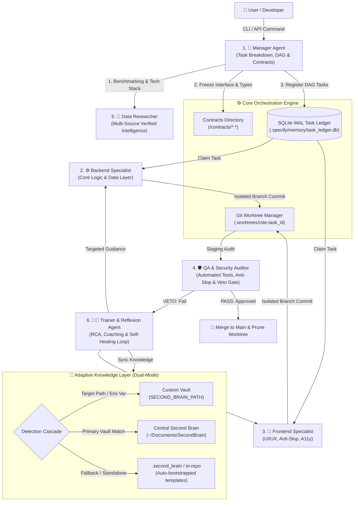
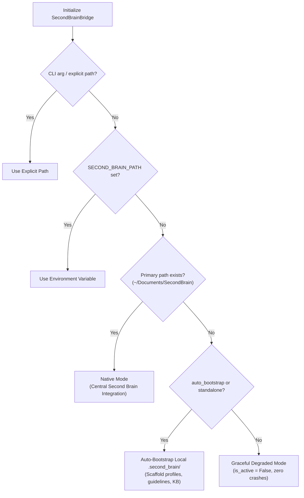
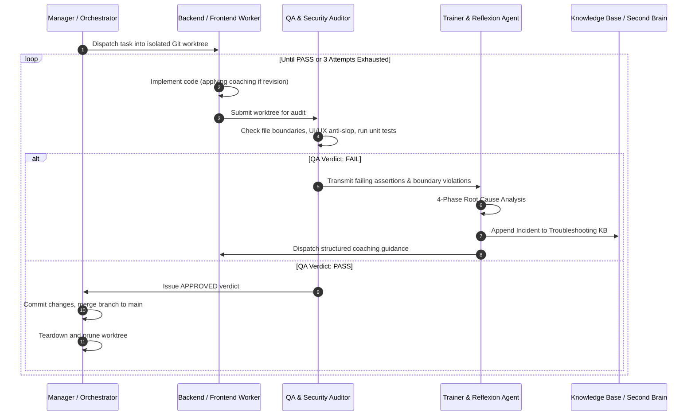

# Sub-Agent Orchestrator: System Architecture Blueprint

## 🏛️ 1. Executive Summary & Core Philosophy

**Sub-Agent Orchestrator** is an autonomous, multi-agent software engineering coordination system designed for high-concurrency development environments (such as Google Antigravity). It organizes **6 specialized autonomous sub-agents** to take software projects from idea to production-ready release while mathematically preventing race conditions, code overwrites, and uncoordinated merges.

### Architectural Core Principles
1. **Ponytail Principle (Lazy Senior Dev Efficiency)**: 
   Standard library first. Zero background daemon footprint (0 MB idle RAM). All coordination state is managed through deterministic file locks, Git worktrees, and SQLite WAL mode transactions.
2. **Deterministic Zero-Collision Guarantee**:
   Agents work in isolated Git worktrees and communicate across frozen, immutable API/schema contracts. Direct commits to `main` are strictly forbidden.
3. **Adaptive Dual-Mode Knowledge Layer**:
   Seamlessly integrates with the user's centralized Second Brain vault (`~/Documents/SecondBrain`), while providing zero-crash standalone fallback and configurable path overrides for external developers on Linux, macOS, and Windows.
4. **Iron Law of Verification**:
   No completion claims without fresh, deterministic verification evidence. The QA & Security Auditor retains absolute veto power over every merge candidate.

---

## 🗺️ 2. High-Level Architecture Topology



---

## 👥 3. The 6-Subagent Contract Matrix & Boundary Invariants

To guarantee that sub-agents never overwrite each other's code, the system enforces strict, deterministic file boundaries defined in `contracts/role_contracts.json` and validated by `WorktreeManager.validate_file_boundaries()`.

| Sub-Agent | Role Slug | Permitted Write Paths | Read-Only Paths | Forbidden Write Paths | Special Mandates |
|---|---|---|---|---|---|
| **1. Manager** | `orchestrator-manager` | `specs/**`, `.specify/**`, `plans/**`, `contracts/**`, `tasks.md` | `**` (All) | `server/**`, `client/**`, `src/**` | Decomposes requirements, generates DAGs, freezes contracts. Never writes production code. |
| **2. Backend** | `backend-engineer` | `server/**`, `backend/**`, `api/**`, `database/**`, `lib/core/**`, `tests/backend/**` | `contracts/**`, `specs/**` | `client/**`, `frontend/**`, `src/components/**`, `styles/**`, `contracts/**` | Ponytail efficiency (stdlib first). Consumes frozen contracts. Zero UI contamination. |
| **3. Frontend** | `frontend-engineer` | `client/**`, `frontend/**`, `src/components/**`, `styles/**`, `public/**`, `tests/frontend/**` | `contracts/**`, `specs/**` | `server/**`, `backend/**`, `api/**`, `database/**`, `contracts/**` | Anti-Slop UI standard, WCAG AA contrast (>=4.5:1), 3 Dials declaration. Consumes frozen contracts. |
| **4. QA & Security** | `qa-security-auditor` | `tests/**`, `e2e/**`, `security/**`, `audit-report.md` | `**` (All) | `server/**`, `client/**`, `src/**` | Absolute veto authority. Executes real test runners. Read-only on production code. |
| **5. Researcher** | `data-researcher` | `research/**`, Knowledge Base `06_DATA_SEARCH/**` | `**` (All) | `server/**`, `client/**`, `src/**`, `tests/**` | Evaluates >= 5 independent credible sources. Enforces <= 45 KB atomic note limits. |
| **6. Trainer** | `trainer-continuous-learning` | `coaching/**`, Knowledge Base `05_PROJECTS/**` | `**` (All) | `server/**`, `client/**`, `src/**`, `tests/**` | 4-phase root cause analysis. Drives self-healing loop. Escalates at 3 consecutive failures. |

### Boundary Invariant Guarantees
1. **Disjoint Implementation Sets**: $\text{Paths}(\text{Backend}) \cap \text{Paths}(\text{Frontend}) = \emptyset$.
2. **Contract Immutability**: Neither Backend nor Frontend can alter `/contracts/` once frozen by the Manager.
3. **Auditor Segregation**: QA cannot modify application code to force a test pass; fixes must come from the worker agent via Trainer coaching.

---

## 🛡️ 4. Zero-Crash Adaptive Knowledge Layer

To maintain **100% backward compatibility for the user's primary environment** while allowing external developers to clone and run the repository on any platform, `SecondBrainBridge` implements a **4-Tier Adaptive Discovery Cascade**:



### Template Auto-Bootstrapping
When running in standalone mode on a foreign system with `auto_bootstrap=True` (or via `sub-agent-orchestrator --standalone init ...`), the orchestrator generates:
- `.second_brain/01_PROFILE/User_Profile.md` (Standalone engineer profile)
- `.second_brain/02_RULES_GUIDELINES/Base_Agent_AI_Guidelines.md` (Clean architecture & Anti-slop standards)
- `.second_brain/05_PROJECTS/Project_Changelog_and_Troubleshooting_Log.md` (Local troubleshooting journal)
- `.second_brain/06_DATA_SEARCH/` (Modular research storage directory)

---

## 💻 5. Cross-Platform Operating System Compatibility

The orchestrator is built to run natively on **Linux, macOS, and Windows**:

1. **Path Normalization**:
   All filesystem boundary validation and Git pattern matching normalize paths via `Path(p).as_posix()`. Patterns with Windows backslashes (`\`) are normalized to forward slashes (`/`) before executing `fnmatch`.
2. **Safe Worktree Teardown**:
   On Windows, background indexing or antivirus handles can lock files temporarily. `WorktreeManager.remove_worktree()` utilizes a resilient cleanup pipeline:
   - Git worktree force removal (`git worktree remove --force`)
   - Git pruning (`git worktree prune`)
   - Resilient filesystem cleanup with permission unmasking (`shutil.rmtree(..., onerror=...)`)
3. **Standard Packaging (PEP 517 / 621)**:
   Packaged via `pyproject.toml` with console script entrypoint:
   ```toml
   [project.scripts]
   sub-agent-orchestrator = "core.cli:main"
   ```
   This automatically installs platform-native executable wrappers (`sub-agent-orchestrator` on POSIX, `sub-agent-orchestrator.exe` on Windows).

---

## 🔄 6. Autonomous Self-Healing Lifecycle & QA Veto Gate

The orchestrator includes a closed-loop self-healing execution model (`auto_execute_lifecycle`):



---

## ✅ 7. Verification & Compliance Checklist

- [x] **Zero Code Overwrite**: Worktrees and role boundaries prevent concurrent edits.
- [x] **100% Contract Preservation**: Contracts are frozen before implementation begins.
- [x] **Dual-Mode Portability**: Works out-of-the-box on foreign environments without hardcoded crash triggers.
- [x] **Full Platform Support**: Linux, macOS, and Windows validated in CI matrix.
- [x] **Atomic Notes Size Compliance**: All documentation and research files stay strictly below 45 KB.
- [x] **Continuous Learning Sync**: Bug resolutions automatically recorded in the Troubleshooting KB.
