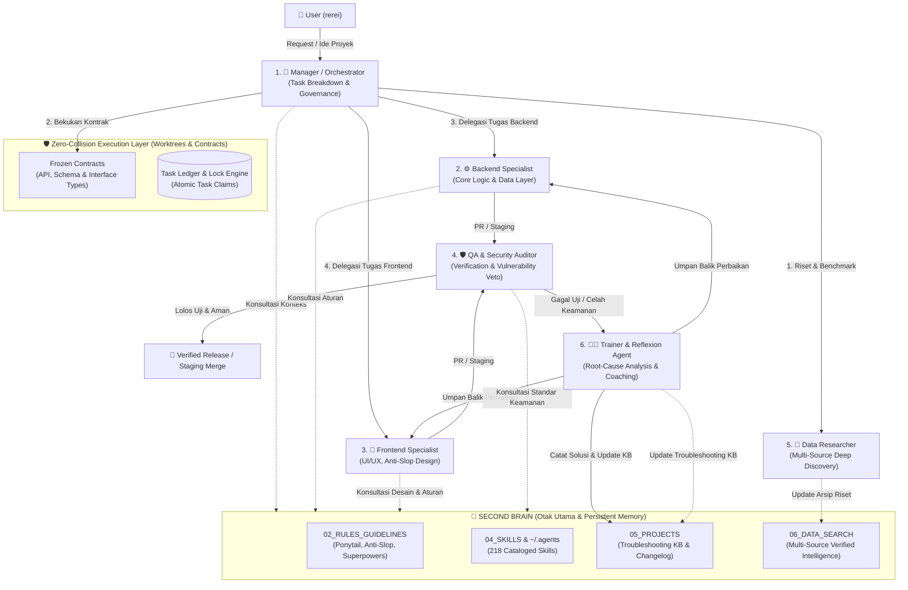

# Feature Specification: Autonomous 6-SubAgent Orchestration System with Second Brain Integration

**Feature Branch**: `001-six-subagents-orchestrator`  
**Created**: 2026-10-11  
**Status**: Ready for Plan / Review  
**Project Path**: `/home/rerei/Documents/Projects/sub-agent orchestrator/`  
**Central Brain Path**: `/home/rerei/Documents/SecondBrain/`  

---

## 📌 1. Executive Summary & Vision

Sistem ini adalah kerangka kerja orkestrasi multi-agen otonom pada lingkungan Google Antigravity yang terdiri dari **6 sub-agen terspesialisasi**. Sistem dirancang untuk mengeksekusi proyek rekayasa perangkat lunak skala penuh dari nol hingga siap produksi tanpa terjadinya tumpang tindih pekerjaan (*race conditions*), penumpukan kode (*merge collisions*), atau perebutan tugas.

Seluruh sub-agen beroperasi dengan menjadikan **Second Brain (`/home/rerei/Documents/SecondBrain/`) sebagai Otak Utama (Shared Central Brain)**: membaca seluruh pedoman koding, katalog 218 skill, riwayat troubleshooting proyek, dan profil sistem sebelum bertindak, serta memperbarui memori jangka panjang ketika menemukan wawasan baru atau menyelesaikan kendala.

---

## 👥 2. Dekomposisi 6 Peran Sub-Agent & Matriks Tanggung Jawab

| No | Sub-Agent | Nama Sistem | Tanggung Jawab Utama | Batasan File (File Boundary) | Hak Akses Second Brain |
|:---:|---|---|---|---|---|
| **1** | **Manager (Orchestrator)** | `orchestrator-manager` | Pengatur alur kerja, dekomposisi task, pembagian tugas atomik, resolusi dependensi, dan review keselarasan proyek. | Membaca semua file; Mengelola `specs/`, `.specify/`, `plans/`, `tasks.md`, `contracts/`. | Baca: `01_PROFILE`, `02_RULES`, `05_PROJECTS`. Tulis: `05_PROJECTS` (Overview & Status). |
| **2** | **Backend Specialist** | `backend-engineer` | Menulis seluruh logika bisnis, database, routing API, microservice, skrip runtime, dan unit test backend. | Terisolasi pada `/server/`, `/backend/`, `/api/`, `/database/`, `/lib/core/`. **Dilarang sentuh UI**. | Baca: `Ponytail_Efficiency`, `Data_Structures_Architecture`, tech stack skills. |
| **3** | **Frontend Specialist** | `frontend-engineer` | Menulis seluruh tampilan antarmuka (UI), komponen responsif, interaksi, aksesibilitas (WCAG), dan styling. | Terisolasi pada `/client/`, `/frontend/`, `/src/components/`, `/styles/`. **Dilarang sentuh database/server**. | Baca: `Anti_Slop_Rules`, `Design_Execution_Protocol`, `Professional_Design_System`, `frontend-design`. |
| **4** | **QA & Security Auditor** | `qa-security-auditor` | Menguji fungsionalitas (TDD/E2E), memverifikasi performa, dan mengaudit celah keamanan (OWASP, injeksi, auth bypass, leak). Memiliki hak **VETO MUTLAK**. | Menulis `/tests/`, `/e2e/`, `/security/`, `audit-report.md`. Mode Read-Only terhadap kode produksi. | Baca: `Superpowers_Core_Pedoman`, `Cybersecurity_and_Penetration_Testing`, `Base_Agent_AI_Guidelines`. |
| **5** | **Data Researcher** | `data-researcher` | Mencari data/referensi online (>5 sumber kredibel) terkait UI benchmark, model, cara kerja arsitektur, keamanan, dan library. | Menulis di `/research/` dan Second Brain `06_DATA_SEARCH/<topik>/`. Tidak menulis kode aplikasi. | Baca: Semua folder Second Brain. Tulis: `06_DATA_SEARCH/<folder_topik>/` (Modular <= 45 KB). |
| **6** | **Trainer & Reflexion Agent** | `trainer-continuous-learning` | Menganalisis kegagalan, mendiagnosis akar masalah bug, melatih sub-agent dengan umpan balik terstruktur, dan mencatat solusi ke Second Brain agar tidak terulang. | Tidak menulis kode aplikasi langsung. Menulis evaluasi performa, patch advisory, dan knowledge base. | Baca & Tulis: `05_PROJECTS/Project_Changelog_and_Troubleshooting_Log.md`, `06_DATA_SEARCH/Agentic_AI_Coding_Problems_and_Fixes_Database/`. |

---

## 🛡️ 3. Mekanisme Zero-Collision & Pencegahan Tumpang Tindih Kode

Untuk menjamin tidak terjadi penumpukan kode (*code overwrite*) atau perebutan pekerjaan (*race condition*), sistem menerapkan **4 Lapisan Isolasi**:

### 3.1. Isolasi Ruang Kerja (Git Worktree Isolation)
- Setiap agen bekerja pada workspace terisolasi:
  - Backend: `.worktrees/backend-worker/` (Branch: `feat/backend-core`)
  - Frontend: `.worktrees/frontend-worker/` (Branch: `feat/frontend-ui`)
  - QA: `.worktrees/qa-staging/` (Branch: `staging/qa-gate`)
- Antigravity subagent invocation menggunakan konfigurasi `Workspace: 'branch'` atau `Workspace: 'share'` sehingga filesystem masing-masing terpisah secara deterministik.

### 3.2. Protokol Pembekuan Kontrak (Contract-First Architecture)
- Sebelum Backend atau Frontend menulis baris kode pertama, **Manager** bersama **Data Researcher** menetapkan dan membekukan kontrak data di direktori immutable: `/contracts/`:
  - `contracts/api.json` (OpenAPI v3.1 Spec)
  - `contracts/types.ts` atau `contracts/schema.py` (Strict Type Definitions)
- Kedua belah pihak mengimpor kontrak yang sama. Backend bertugas menyediakan implementasi kontrak, sedangkan Frontend bertugas mengonsumsi kontrak (menggunakan mocks selama backend dibangun).

### 3.3. Penguncian Tugas Tunggal (Task Locking Ledger)
- Daftar tugas disimpan secara terstruktur di `.specify/memory/tasks_ledger.json` atau SQLite WAL database.
- Setiap tugas hanya memiliki satu status dan satu pemilik:
  - `IDLE` -> `CLAIMED [agent_id]` -> `IN_PROGRESS` -> `READY_FOR_REVIEW` -> `VERIFIED` -> `MERGED`.
  - Agen lain dilarang keras mengeksekusi tugas berstatus `CLAIMED` atau `IN_PROGRESS`.

### 3.4. Gerbang Penggabungan Deterministik (Deterministic Staging Gatekeeper)
- Subagent dilarang melakukan merge langsung ke branch `main`.
- Hasil kerja subagent diajukan ke branch `staging`.
- **QA & Security Auditor** menjalankan automated verification gate:
  1. Unit tests pass (100% Green).
  2. Integration & Contract tests pass.
  3. Linter & Static Analysis (0 error).
  4. Security Vulnerability Scan (0 Critical / High).
- Hanya pekerjaan yang lulus gerbang QA yang dapat digabungkan ke branch utama oleh **Manager**.

---

## 🧠 4. Protokol Integrasi Second Brain Sebagai Otak Utama

Setiap sub-agent dihubungkan secara native dengan repositori Second Brain di `/home/rerei/Documents/SecondBrain/`:

### 4.1. Pre-Flight Knowledge Ingestion (Wajib Baca Sebelum Eksekusi)
1. **Trigger `(sb)` Enforced**: Setiap sub-agent saat diluncurkan wajib menyinkronkan konteksnya dengan membaca:
   - Profil Pengguna & Aturan Pemisahan Kode: `01_PROFILE/User_Profile.md`
   - Pedoman Rekayasa Utama: `02_RULES_GUIDELINES/Base_Agent_AI_Guidelines.md`
   - Log Troubleshooting: `05_PROJECTS/Project_Changelog_and_Troubleshooting_Log.md`
2. **Skill Auto-Routing**: Sub-agent membaca katalog di `04_SKILLS/Agents_Skills_Catalog.md` atau `04_SKILLS/Skills_Auto_Routing_Table.md` dan memanggil skill yang relevan melalui `view_file` sebelum menulis implementasi.

### 4.2. Continuous Learning & Troubleshooting Log Sync (Trainer Mandate)
1. Setiap kali terjadi error atau kegagalan tes:
   - **QA** memveto dan membekukan status task.
   - **Trainer** dipicu secara otomatis untuk membaca stack trace dan log eksekusi.
   - Trainer mencari solusi dari `Project_Changelog_and_Troubleshooting_Log.md` atau riset online via Data Researcher.
   - Trainer merumuskan *Actionable Fix Guidance* untuk Backend/Frontend.
   - Setelah perbaikan diverifikasi sukses oleh QA, Trainer **WAJIB mencatat kasus baru** ke tabel Troubleshooting Knowledge Base:
     - **Gejala (Symptom)**: Pesan error aktual dan konteks terjadinya.
     - **Akar Masalah (Root Cause)**: Penjelasan teknis mengapa error terjadi.
     - **Solusi (Resolution)**: Langkah perbaikan spesifik yang berhasil.
     - **Pelajaran Masa Depan (Preventive Rule)**: Aturan agar sub-agent tidak mengulanginya lagi.

### 4.3. Batasan Keras Ukuran File (Zero Truncation <= 45 KB)
- Seluruh dokumen riset, spesifikasi, dan catatan Second Brain yang dibuat oleh sub-agent **DILARANG MELEBIHI 45 KB** (~46.080 bytes).
- Jika data riset atau dokumentasi berukuran besar, sub-agent wajib memecahnya secara modular menjadi file terpisah yang ditautkan di `README.md` induk.

---

## 🎯 5. User Stories & Alur Perjalanan (Prioritized Journeys)

### User Story 1 — Manager Membagi Tugas & Mengatur Orkestrasi Tanpa Bentrok (Priority: P1)
Sebagai pengguna, saya ingin memberikan perintah pembuatan proyek perangkat lunak baru kepada sistem, sehingga Manager secara mandiri membuat spesifikasi, memecah tugas menjadi modul terisolasi, menetapkan kontrak antarmuka, dan mendelegasikan tugas ke sub-agent tanpa saling bertabrakan.

- **Why this priority**: Tanpa orkestrasi yang jelas dan pembekuan kontrak, multi-agent akan saling menimpa kode dan mengalami kekacauan koordinasi.
- **Independent Test**: Jalankan simulasi inisiasi proyek; verifikasi bahwa file `contracts/` terbuat dan tugas di `tasks.md` terbagi rapi dengan penanda kepemilikan file unik.
- **Acceptance Scenarios**:
  1. **Given** Prompt proyek dari pengguna, **When** Manager menerima instruksi, **Then** Manager membuat breakdown arsitektur, membekukan kontrak data, dan mengunci file boundary sebelum sub-agent bekerja.
  2. **Given** Dua sub-agent aktif bersamaan, **When** Backend dan Frontend mengeksekusi tugasnya, **Then** Keduanya bekerja pada direktori/worktree masing-masing tanpa konflik Git.

---

### User Story 2 — Backend & Frontend Bekerja Paralel Berbasis Kontrak (Priority: P1)
Sebagai pengguna, saya ingin Backend Specialist menulis logika bisnis/database dan Frontend Specialist menulis antarmuka UI secara simultan tanpa harus saling menunggu implementasi selesai.

- **Why this priority**: Menghasilkan efisiensi waktu eksekusi maksimal (*high throughput*) dengan jaminan kompatibilitas saat integrasi.
- **Independent Test**: Periksa commit history; Backend mengimplementasikan endpoint API sesuai skema `contracts/types.ts` dan Frontend mengimplementasikan antarmuka dengan memanggil API contract yang sama.
- **Acceptance Scenarios**:
  1. **Given** Kontrak API telah dibekukan, **When** Backend dan Frontend bekerja simultan, **Then** Backend menguji unit test endpoint dan Frontend menguji antarmuka menggunakan mock/live client yang sesuai tipe kontrak.

---

### User Story 3 — QA & Security Auditor Melakukan Evaluasi Mutu & Keamanan dengan Hak Veto (Priority: P2)
Sebagai pengguna, saya ingin setiap perubahan kode diverifikasi secara objektif oleh QA & Security Auditor, sehingga tidak ada celah keamanan (OWASP, SQLi, XSS, token leakage) atau penurunan performa yang lolos ke hasil akhir.

- **Why this priority**: Menegakkan *Iron Law of Verification* dan mencegah aplikasi rentan terhadap serangan siber atau crash runtime.
- **Independent Test**: Uji kode dengan bug buatan atau celah keamanan; verifikasi bahwa QA mengeluarkan status REJECTED dan memblokir penggabungan kode.
- **Acceptance Scenarios**:
  1. **Given** Kode yang diajukan memiliki kerentanan keamanan atau tes yang gagal, **When** QA menjalankan audit, **Then** QA memveto rilis, membuat tiket temuan spesifik, dan meneruskannya ke Trainer.
  2. **Given** Seluruh tes hijau (100% pass) dan scan keamanan bersih, **When** QA mengaudit, **Then** QA memberikan stempel APPROVED beserta bukti eksekusi segar.

---

### User Story 4 — Data Researcher Menyediakan Wawasan & Solusi Terkini dari Multi-Sumber (Priority: P2)
Sebagai pengguna, saya ingin Data Researcher mencari referensi online terkini (>5 sumber kredibel) untuk UI, library, skema database, atau mitigasi celah keamanan yang dibutuhkan proyek.

- **Why this priority**: Mencegah halusinasi AI, memastikan implementasi menggunakan standar versi library terbaru, dan memberikan keunggulan kompetitif pada desain serta arsitektur.
- **Independent Test**: Minta referensi fitur kompleks; Data Researcher menghasilkan dokumen riset substansial di `06_DATA_SEARCH/` dengan data teknis utuh dan sitasi jelas.
- **Acceptance Scenarios**:
  1. **Given** Kebutuhan referensi desain atau teknologi baru, **When** Data Researcher dipanggil, **Then** Researcher mencari lebih dari 5 sumber independen dan menyajikan data teknis komprehensif tanpa merusak data inti.

---

### User Story 5 — Trainer Melatih Sub-Agent Saat Terjadi Kesalahan & Mencatat ke Second Brain (Priority: P3)
Sebagai pengguna, saya ingin ketika sub-agent melakukan kesalahan (error build, kegagalan logika, atau celah keamanan), Trainer secara otomatis melatih agen tersebut dan mencatat kasusnya ke Second Brain agar kesalahan yang sama tidak pernah terulang.

- **Why this priority**: Mewujudkan sistem kecerdasan yang berevolusi (*self-evolving system*) dengan memori jangka panjang tanpa batas sesi.
- **Independent Test**: Simulasikan kegagalan build/tes berulang; verifikasi bahwa Trainer menganalisis penyebab, memberikan instruksi koreksi, dan mencatat kasus ke `Project_Changelog_and_Troubleshooting_Log.md`.
- **Acceptance Scenarios**:
  1. **Given** Kegagalan tugas yang dilaporkan QA, **When** Trainer mengintervensi, **Then** Trainer mengisolasi akar masalah, memberikan koreksi terarah, dan menyinkronkan pelajaran ke Second Brain.
  2. **Given** Error yang serupa terjadi di masa depan, **When** Sub-agent memeriksa Second Brain, **Then** Solusi langsung diaplikasikan tanpa mengulangi kesalahan awal.

---

## 📋 6. Kebutuhan Fungsional (Functional Requirements)

### 6.1. Orkestrasi & Tata Kelola (Orchestration & Governance)
- **FR-001**: Sistem HARUS memiliki agen `orchestrator-manager` yang berfungsi sebagai koordinator tunggal penerima perintah pengguna.
- **FR-002**: Manager HARUS memecah proyek menjadi tugas-tugas atomik dengan dependency graph yang jelas (DAG).
- **FR-003**: Manager HARUS membekukan kontrak antarmuka di `/contracts/` sebelum pengerjaan paralel dimulai.
- **FR-004**: Sistem HARUS mencegah dua sub-agent memodifikasi file yang sama secara bersamaan menggunakan skema *File Boundary Ownership*.

### 6.2. Implementasi Backend & Frontend (Implementation Modules)
- **FR-005**: Agen `backend-engineer` HARUS hanya menulis kode di direktori backend/server/database dan unit test terkait.
- **FR-006**: Backend HARUS mematuhi standar *Ponytail Efficiency* (stdlib-first, zero-bloat, tangguh).
- **FR-007**: Agen `frontend-engineer` HARUS hanya menulis kode di direktori frontend/UI/styles dan komponen terkait.
- **FR-008**: Frontend HARUS mematuhi standar *Anti-Slop* (desain berkarakter, WCAG AA contrast, no generic blobs/gradients).

### 6.3. Penjaminan Mutu & Keamanan (QA & Security)
- **FR-009**: Agen `qa-security-auditor` HARUS menguji seluruh fungsi dan komponen menggunakan test runner lokal aktual.
- **FR-010**: QA HARUS memeriksa kepatuhan keamanan terhadap OWASP Top 10, sanitasi input, token protection, dan least privilege.
- **FR-011**: QA HARUS memiliki hak veto mutlak untuk menolak (*reject*) branch yang tidak lulus uji atau memiliki celah keamanan.
- **FR-012**: QA DILARANG menyatakan lulus tanpa bukti eksekusi tes yang baru saja dijalankan (*Hukum Besi Verifikasi*).

### 6.4. Riset & Data Mining (Research)
- **FR-013**: Agen `data-researcher` HARUS mengumpulkan data dari $\ge 5$ sumber kredibel independen (web, docs, GitHub, LLM lain).
- **FR-014**: Data Researcher HARUS menyajikan data teknis aktual secara substantif, bukan sekadar tautan kosong.
- **FR-015**: Data Researcher HARUS menyimpan catatan riset di Second Brain `06_DATA_SEARCH/<folder_topik>/` secara terstruktur dan modular ($\le 45$ KB).

### 6.5. Pembelajaran Mandiri & Troubleshooting (Training & Memory)
- **FR-016**: Agen `trainer-continuous-learning` HARUS menganalisis setiap kegagalan yang dilaporkan QA atau error runtime.
- **FR-017**: Trainer HARUS merumuskan rencana perbaikan berbasis investigasi 4 fase (Root Cause, Pola, Hipotesis, TDD).
- **FR-018**: Trainer HARUS mencatat setiap insiden dan perbaikannya ke `05_PROJECTS/Project_Changelog_and_Troubleshooting_Log.md` di Second Brain.
- **FR-019**: Trainer HARUS memperbarui aturan atau panduan di Second Brain jika ditemukan pola kegagalan berulang.

### 6.6. Integrasi Second Brain & Lingkungan Lokal
- **FR-020**: Seluruh sub-agent HARUS memiliki akses baca ke `/home/rerei/Documents/SecondBrain/`.
- **FR-021**: Seluruh kode sumber proyek HARUS disimpan di `/home/rerei/Documents/Projects/<nama-proyek>/`.
- **FR-022**: Second Brain DILARANG menyimpan implementasi kode sumber proyek (hanya catatan, spec, changelog, dan KB).
- **FR-023**: Seluruh dokumen Markdown yang dihasilkan sub-agent HARUS mematuhi batas ukuran $\le 45$ KB.

---

## ⚠️ 7. Kasus Batas & Penanganan Eksepsi (Edge Cases)

| Skenario Eksepsi | Dampak Potensial | Protokol Penanganan Sistem |
|---|---|---|
| **Perubahan Kontrak di Tengah Jalan** | Backend & Frontend pecah (*breaking change*). | Sub-agent dilarang mengubah `/contracts/` secara sepihak. Harus mengajukan eskalasi ke **Manager**. Manager membekukan sementara tugas, memperbarui kontrak, dan menyinkronkan kedua agen. |
| **Deadlock Antar Tugas** | Agen A menunggu Agen B dan Agen B menunggu Agen A. | Manager menerapkan *DAG Cycle Detection*. Jika terdeteksi siklus, Manager memecah tugas menjadi intermedier mock contract. |
| **Kegagalan Perbaikan 3 Kali Berturut-turut** | Agen terjebak dalam perbaikan berulang tanpa hasil. | Menerapkan *Aturan 3 Kali Gagal (Superpowers)*: Hentikan iterasi otomatis. Trainer menandai bahwa ini adalah cacat arsitektur dan meminta tinjauan pengguna. |
| **Truncation Dokumen (> 45 KB)** | Dokumen terpotong saat dibaca oleh tool AI. | Auto-Split Guardrail: Trainer atau Manager memecah dokumen menjadi `Part1.md`, `Part2.md` dan menautkannya di `README.md`. |
| **Bentrok Git / File Lock** | `.git/index.lock` atau konflik merge. | File locking timeout 10 detik. Jika terjadi konflik di staging, staging di-revert ke keadaan bersih terakhir dan sub-agent diminta melakukan rebase dari kontrak terupdate. |

---

## 📊 8. Kriteria Keberhasilan Terukur (Measurable Success Criteria)

- **SC-001 (Zero Code Overwrite)**: 0 insiden penimpaan kode atau konflik merge antar sub-agent selama siklus hidup proyek berlangsung.
- **SC-002 (100% Contract Compliance)**: 100% antarmuka antara Backend dan Frontend lolos uji verifikasi tipe data dan integrasi kontrak.
- **SC-003 (Zero Regression / Zero Unverified Claim)**: 100% klaim keberhasilan fitur disertai bukti eksekusi tes aktual dengan exit code `0`.
- **SC-004 (Zero Security Vulnerability)**: 0 celah keamanan kategori Critical dan High (OWASP Top 10) pada kode produksi akhir.
- **SC-005 (Continuous Knowledge Retention)**: 100% kendala dan bug baru tercatat secara otomatis ke dalam Troubleshooting Knowledge Base di Second Brain.
- **SC-006 (Zero Repeated Errors)**: Sub-agent tidak mengulangi kesalahan yang polanya telah terdokumentasi di Troubleshooting Knowledge Base.
- **SC-007 (Strict Boundary Compliance)**: 0 baris kode sumber proyek yang tersimpan di dalam folder Second Brain (100% berada di `~/Documents/Projects/`).
- **SC-008 (Strict Size Compliance)**: 0 file Markdown yang melebihi batas 45 KB.

---

## 🛠️ 9. Asumsi & Ketergantungan Sistem

1. **Lingkungan OS**: Linux Mint 22.3 / Ubuntu 24.04 LTS x86_64 dengan Node.js, Python, Git, dan Antigravity Agent Tooling.
2. **Path Second Brain**: Terletak permanen di `/home/rerei/Documents/SecondBrain/`.
3. **Mekanisme Subagent**: Dieksekusi melalui Google Antigravity Subagent Engine (`invoke_subagent`, `define_subagent`, `send_message`).
4. **Isolasi Git**: Memanfaatkan fitur native Git Worktree dan Branch isolation pada folder repositori proyek.

---

*Spesifikasi ini dirancang sesuai standar GitHub Spec Kit & Second Brain Architecture Rules.*
